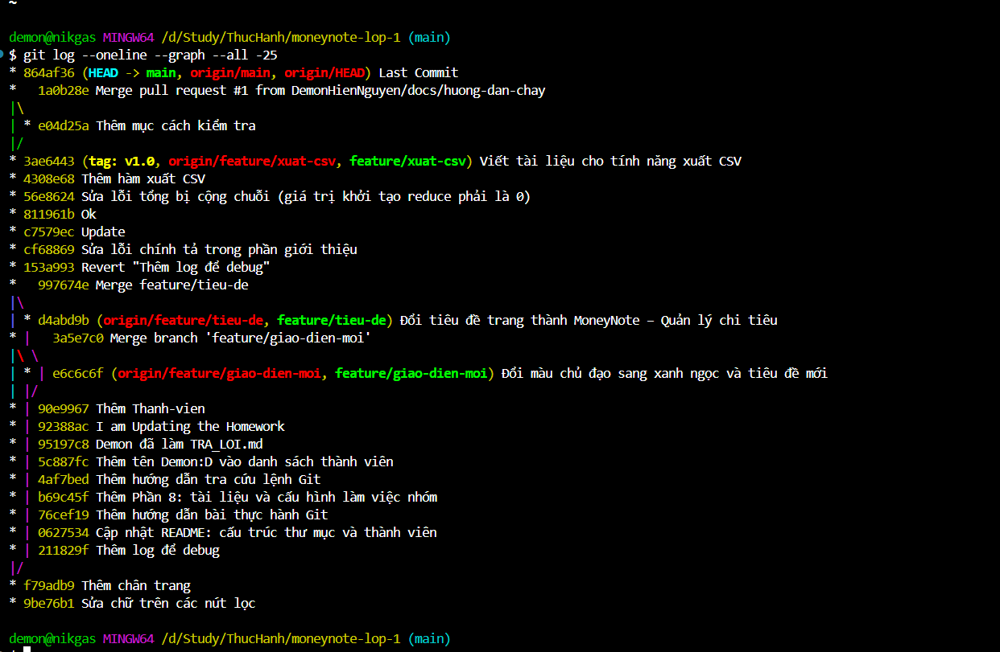

❓ **Câu 1.** Lúc mới nhận repo, nhánh `main` có bao nhiêu commit? Kể tên 4 nhánh còn lại.

+ Nhánh main có 15 commit
+ Các nhánh còn lại:
  + hotfix/sua-loi-cong
  + feature/tieu-de
  + feature/giao-dien-moi
  + feature/xuat-csv

❓ **Câu 2.** Bạn Lan có bao nhiêu commit trong toàn bộ repo (gợi ý: thêm `--all`)?

* 62b5cde (origin/hotfix/sua-loi-cong) Thử nghiệm font Comic Sans (chưa chốt)
* b5056bb Sửa lỗi tổng bị cộng chuỗi (giá trị khởi tạo reduce phải là 0)
* d4abd9b (origin/feature/tieu-de) Đổi tiêu đề trang thành MoneyNote – Quản lýchi tiêu
* f79adb9 Thêm chân trang
* 9be76b1 Sửa chữ trên các nút lọc
* 9960310 (tag: v0.1) Định dạng số tiền kiểu Việt Nam
* c1faea8 Thêm style cơ bản

7 loại commit

❓ **Câu 3.** Dòng có chữ `reduce` trong `js/tinh-toan.js` do ai viết, ở commit nào?

df17ab7d (Lê Hùng     2026-10-08 20:45:00 +0700  6)     .reduce(function (tong, g) { return tong + g.soTien;}, '');

Do Lê Hùng Viết, ở commit "Thêm hàm tính tổng thu, tổng chi"

❓ **Câu 4.** `git diff` và `git diff --staged` khác nhau thế nào? Vì sao file `.env` không bao giờ nên đưa lên Git?

`git diff` dùng để xem các thay đổi chưa được thêm vào vùng chờ (Staging Area), trong khi `git diff --staged` dùng để xem các thay đổi đã được thêm vào vùng chờ và sẵn sàng để commit.

File `.env` chứa các thông tin cấu hình nhạy cảm của dự án, việc đưa file này lên Git sẽ tạo ra những rủi ro nghiêm trọng về bảo mật và quản lý hệ thống.

❓ **Câu 5.** Vì sao 3.1 là fast-forward còn 3.2 lại tạo merge commit?

* **3.1 (Fast-forward):** Nhánh `main` chưa có commit mới nào kể từ khi tách nhánh. Git chỉ cần "tua nhanh" con trỏ `main` lên vị trí của `feature/gioi-thieu` mà không cần tạo commit mới.
* **3.2 (Merge commit):** Nhánh `main` lúc này **đã có commit mới** (từ bước 3.1). Lịch sử bị rẽ nhánh nên Git phải dùng thuật toán gộp 3 bên và tạo ra một **merge commit** để nối lại.

❓ **Câu 6.** Vì sao gộp `feature/giao-dien-moi` không xung đột, còn `feature/tieu-de` thì có?

+ Gộp feature/giao-dien-moi (Không xung đột): Bạn Hùng sửa ở file hoặc vị trí khác với bạn (bạn thêm file .md, bạn Hùng sửa index.html). Git tự động gộp được.
+ Gộp feature/tieu-de (Xung đột): Cả hai nhánh cùng sửa chung một dòng trong file index.html. Git không biết chọn ai nên bắt con người tự xử lý.

❓ **Câu 7.** Vì sao dùng `git revert` chứ không dùng `git reset` để gỡ commit đã có trên nhánh chung?

* Vì `git revert` tạo ra một commit mới để đảo ngược thay đổi, giúp giữ nguyên lịch sử và không làm ảnh hưởng đến code của người khác trên nhánh chung
* `Nếu dùng git reset, lịch sử commit sẽ bị xóa bỏ hoàn toàn.`

❓ **Câu 8.** `reset --soft`, `reset --mixed` (mặc định) và `reset --hard` khác nhau thế nào?

* **`--soft`:** Chỉ hủy commit, giữ nguyên code đã `git add`. Dùng khi muốn **gộp commit** hoặc  **viết lại thông điệp** **.**
* **`--mixed`:** Hủy commit và hủy luôn `git add`. Code quay về trạng thái chưa làm gì, dùng khi muốn **chia nhỏ commit** hoặc  **add lại từ đầu** **.**
* **`--hard`:** Xóa sạch sành sanh mọi thứ. Dùng khi code hiện tại đã nát và bạn muốn **đập đi làm lại** từ một commit cũ trong quá khứ.

❓ **Câu 9.** Commit gây lỗi là commit nào (mã, thông điệp, tác giả)? Dùng `git show <mã>` và giải thích ngắn gọn vì sao code đó gây lỗi.

commit e6c6c6f372bde3dc9bf79e7c00c1cb601492a732 (HEAD, origin/feature/giao-dien-moi, feature/giao-dien-moi)
Author: Lê Hùng <hung@example.com>
Date:   Thu Oct 15 19:00:00 2026 +0700

    Đổi màu chủ đạo sang xanh ngọc và tiêu đề mới

 css/style.css | 2 +-
 index.html    | 2 +-
 2 files changed, 2 insertions(+), 2 deletions(-)

Giải thích: Mặc dù Commit chỉ sửa giao diện nhưng tác giả thay đỏi thuộc tính type = "number" thành type = "text" tại ô nhập liệu số tiền thu, điều này khiến JS  khi lấy giá trị từ ô nhập liệu bằng thuộc tính .value thì sẽ nhận dưới dạng chuooixu thay vì số, khi thực hiện phép  cộng thì JS tự hiểu đây là phép cộng chuỗi dẫn dến sai lệch dạng văn bản

❓ **Câu 10.** Nếu dùng `git merge hotfix/sua-loi-cong` thay cho `cherry-pick` thì chuyện gì xảy ra?

* Bị lẫn code chưa duyệt: Nhánh `main` sẽ lấy về toàn bộ các commit của nhánh hotfix, bao gồm cả commit thử nghiệm font Comic Sans (chưa được duyệt).
* Sai kết quả mong đợi: Giao diện trang web sẽ bị đổi font chữ sang Comic Sans, không đạt yêu cầu của bài thực hành.

❓ **Câu 11.** Sau rebase, mã commit "Thêm hàm xuất CSV" có giống mã cũ không? Vì sao không nên rebase một nhánh mà bạn khác đã kéo về máy?

+ Sau rebase mã commit "Them hàm xuất CSV" bị thay đổi thành mã mới
+ Vì rebase sễ tính toán lại giá trị băm dựa trên commit gốc mới, thời gian tạo mới và commit cha mới
+ Vì lệnh sẽ thay đổi và viết lại lịch sử commit. Nếu người khác đã kéo nhánh cũ về, khi họ cập nhật sẽ bị lỗi xung đột nghiêm trọng và làm xáo trộn, hổng lịch sử git trên máy của họ

❓ **Câu 12.** `git fetch` và `git pull` khác nhau thế nào?

`git pull` chính là bằng `git fetch` cộng với `git merge`.

* `git fetch`: Chỉ tải code mới từ server về máy (lưu trong bộ nhớ đệm), không làm thay đổi code hiện tại bạn đang gõ. Bạn có thể an tâm kiểm tra trước khi gộp.
* `git pull`: Vừa tải code mới về, vừa tự động gộp thẳng vào nhánh bạn đang đứng. Cách này nhanh hơn nhưng dễ gây xung đột (conflict) bất ngờ nếu bạn chưa chuẩn bị trước.

```bash
git log --oneline --graph --all -25
```



---
